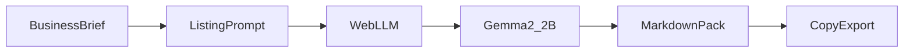

*This is a submission for the [Hacktoberfest Open-Source AI Challenge: Week 2 — Side Hustle](https://dev.to/challenges/hacktoberfest-week2-2026-10-12)*

## What I Built

**Local Listing Nepal** turns a short Nepal small-business brief into a ready-to-paste listing pack:

- Google Business short + full descriptions
- Suggested categories / services
- Facebook About + 3–5 starter post captions
- Hamrobazar / marketplace title + description when relevant
- Nepali (Devanagari) short + full descriptions
- Honest local search phrases
- Assumptions / questions instead of invented “facts”

The open-weight model runs **in the browser** with WebLLM + WebGPU. Default model: **Gemma 2 2B**. No backend, no API key, nothing sent to a paid API by default.

I run client digital marketing work through [Gurkha Technology](https://gurkhatech.com) in Kathmandu. Shop owners often need stronger Google Business and Facebook copy (including Nepali), but a full agency package is expensive when they only need a listing pack. This tool is the draft step I wish I could hand them — and that freelancers here could resell as a micro-service.

## Who Would Pay

- Nepal SMBs (cafes, clinics, tutors, service shops) who currently pay NPR for listing rewrites
- Freelancers productizing “listing packs” for clients
- Small agencies that want a faster first draft before human polish

## Demo

**Live (GitHub Pages):** https://arjankc.github.io/local-listing-nepal/

1. Open in recent Chrome or Edge (WebGPU required).
2. Fill a brief (try Lakuri Hills Cafe in Lakuri Phedi, Lalitpur).
3. Click **Generate listing pack** — first run downloads ~1–1.5 GB into browser cache.
4. Copy a section, copy all Markdown, or download `.md`.

## Code



## How I Built It

Hardware constraint: aging integrated graphics. That forced small models and a lightweight UI.

- **Vite + React + Tailwind** static SPA, hosted on GitHub Pages
- **WebLLM** loads Gemma 2 2B (with Qwen 1.5B / Llama 1B fallbacks)
- Quantization auto-pick: `q4f16_1` vs `q4f32_1` based on `shader-f16`
- **Temperature 0.15** and a fixed Markdown heading schema so the UI can offer per-section copy buttons
- Prompt rules: never invent amenities/prices/awards; use `[Ask the business]` for gaps; preserve NAP and brand spelling; natural written Nepali, not awkward literal translation
- Gemma has no system role in the chat template, so instructions ride in the user turn

The WebLLM load/progress pattern was proven earlier on my separate project [Nepali String Localizer](https://github.com/arjankc/Localized-String-Assistant). This repo is a new product for listing packs, not a rebrand of that translator.

## Why Open Innovation Matters

**Cost from Nepal.** International paid APIs and cards are painful here. An open-weight model in the tab means the product can stay free or cheap to operate while still useful.

**Privacy for SMB briefs.** Phone numbers, addresses, and unfinished offers stay on the shop owner’s machine. That matters when you are drafting listings for someone’s real business.

**Nepali + English without locking into one vendor.** Gemma’s multilingual strength is why it is the default. Because weights are open, I can swap models as WebLLM’s catalog improves — without rewriting the product around a closed API.

**Side hustle that is actually sellable.** Freelancers can charge for the human review step and still start from a structured pack in seconds, without paying per-token fees that erase the margin.

## Prize Categories

- **Best Use of Gemma** — Gemma 2 2B is the default in-browser model for bilingual listing generation

## First user

*[Replace before publish: 2–3 honest sentences after showing the demo to one shop owner or freelancer — what they liked, whether they would pay, what they asked for next.]*

## Checklist before you publish

- [ ] Live demo URL works on Chrome/Edge
- [ ] Repo is public with MIT + README
- [ ] Fill in First user section honestly
- [ ] Confirm tags include `hf26challenge`
- [ ] Publish before Sunday 18 Oct 2026, 11:59 PM PDT
